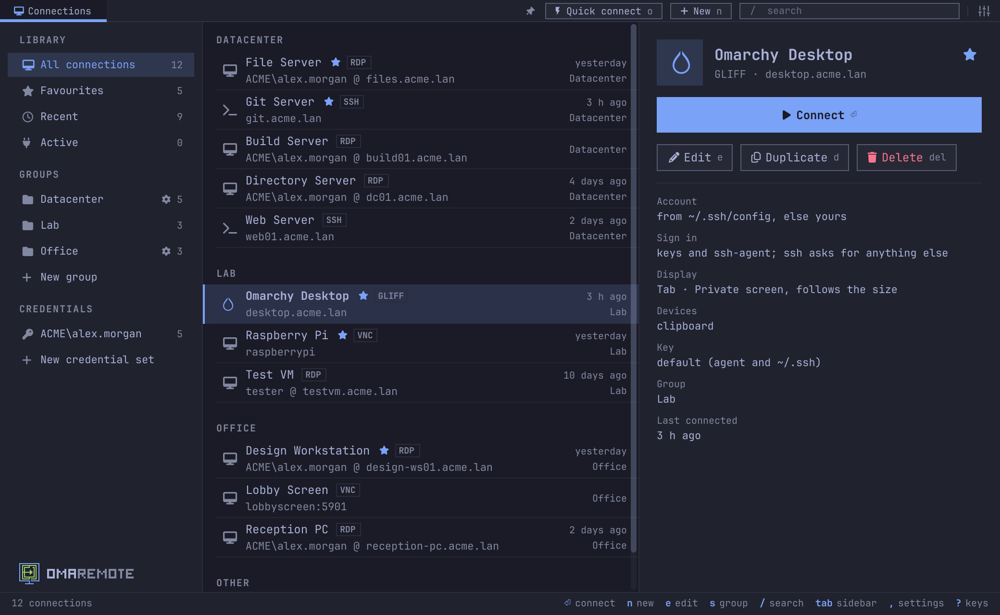
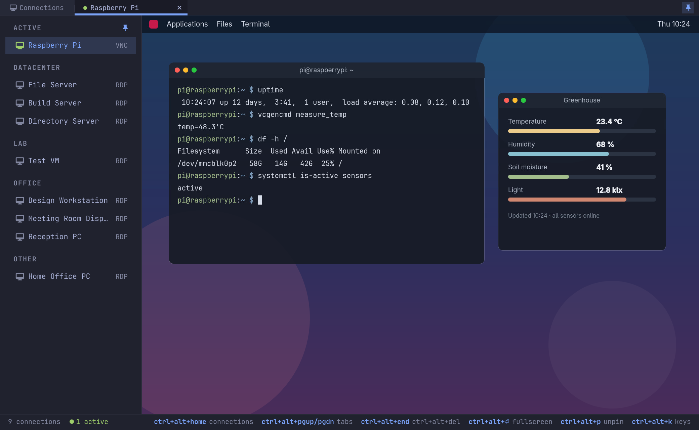
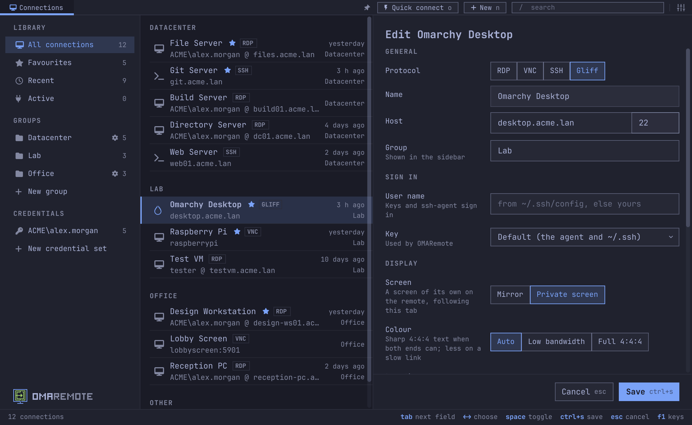
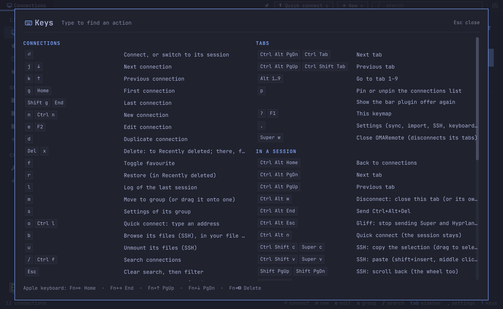

# OMARemote

A keyboard-first remote desktop client for [Omarchy](https://omarchy.org), styled after
[Flea](https://github.com/thisisgm/flea): a Quickshell UI built from Omarchy's own shell components
(`/usr/share/omarchy/shell/Commons` and `Ui`), so it follows your theme, live.



- **RDP** through FreeRDP, **VNC** through libvncclient, and **SSH** in a terminal drawn in the tab.
- **Sessions in tabs** inside the app, or (RDP) in their own window for multi-monitor; pin the
  connections list beside them and the remote desktop resizes to fit.
- **HiDPI scaling** that follows Hyprland: the remote desktop matches the tab's size and your scale.
- **Credential sets** shared between hosts, and **group settings** that connections inherit.
- **Fast Kerberos** on networks with many domain controllers.
- **Keyboard-driven**, with a keymap sheet on `?`; the mouse works everywhere too.
- Passwords optional, in your keyring; sessions in their own or hotkey window run on when you close
  OMARemote, and an update brings your tabs back.

## Screenshots

A VNC session in a tab, with the connections list pinned beside it; the desktop resizes to the room
left:



| Editing a connection; its credentials come from its group | Every key, on `?` |
| --- | --- |
|  |  |

The screenshots use made-up sample data and a mock desktop.

## Install

> **Early development.** OMARemote 0.8.2 works day to day, but it is young: expect rough edges,
> and please [report what you run into](https://github.com/RFdeGroot/OMARemote/issues).

### From a release (recommended)

Each [release](https://github.com/RFdeGroot/OMARemote/releases) has ready-built Arch packages for
Intel/AMD (`x86_64`) and for Omarchy on Apple Silicon (`aarch64`, Arch Linux ARM). These commands
download the newest one for your machine, and pacman installs it together with everything it needs:

```bash
url=$(curl -s https://api.github.com/repos/RFdeGroot/OMARemote/releases | grep -o "https://[^\"]*-$(uname -m)\.pkg\.tar\.zst" | head -1)
curl -LO "$url"
sudo pacman -U "./${url##*/}"
omaremote                    # or "OMARemote" from the launcher
```

(The first line asks GitHub for the newest release, pre-releases included; you can also download a
package from the [releases page](https://github.com/RFdeGroot/OMARemote/releases) by hand.)

Release packages are not signed yet. pacman installs an unsigned package from a file on disk, but
refuses one straight from a URL (`failed retrieving file '….pkg.tar.zst.sig'`), hence the download.

#### Updating

From 0.1.5-alpha on, OMARemote updates itself:

1. At startup it asks GitHub once whether there is a newer release with a package for your machine.
2. If there is, an **Update to …** button appears at the bottom of the sidebar, above the OMARemote
   logo (also reachable with the keyboard: `tab` to the sidebar, then down to the button). The
   version you run is in the About card: click the logo.
3. Clicking it opens a floating terminal that downloads the package, checks its signature against
   OMARemote's release key (from 0.4.0 every release is signed; a package that does not check out
   is never installed), and installs it with `sudo pacman -U` (type your password there), then
   restarts OMARemote on the new version.
   Running sessions keep going and come back as tabs.

The button runs `omaremote-update`, which you can also run yourself in a terminal, any time:

```bash
omaremote-update             # install the newest release for this machine, restart OMARemote
omaremote --version          # the version you have
```

Updating by hand works too: run the install commands above again, and pacman upgrades OMARemote in
place; then `omaremote restart` (which keeps your tabs; `super+w` would disconnect them). Each release's notes say what changed; to
hear about new ones, use *Watch → Custom → Releases* on the GitHub page.

**The bar plugin.** The sidebar's footer also looks after the
[Omarchy bar plugin](https://github.com/RFdeGroot/omarchy-omaremote): when it is not installed,
an *Install bar plugin* button runs `omarchy plugin add` for it in a floating terminal (where Omarchy
asks where in the bar it goes); when the plugin has a newer release, *Update bar plugin* runs
`omarchy plugin update rfdegroot.omaremote` there. Not interested? *hide* next to "Bar plugin not installed"
(or `x` on the button) keeps the offer away for good; "Show the bar plugin offer again" in the
keymap (`?`) brings it back.

**Turning the startup check off.** The check is two requests to `api.github.com` when OMARemote
starts (OMARemote and the plugin). To skip it, set `OMAREMOTE_NO_UPDATE_CHECK=1` in the environment Omarchy gives your apps,
then log out and back in:

```bash
mkdir -p ~/.config/environment.d
echo 'OMAREMOTE_NO_UPDATE_CHECK=1' > ~/.config/environment.d/omaremote.conf
```

For a single run, start it as `OMAREMOTE_NO_UPDATE_CHECK=1 omaremote` instead. Remove the file
(and log in again) to turn the check back on; `omaremote-update` works either way.

A checkout (see below) shows `(dev)` after the version and never offers the button; it only
mentions that a newer release exists. Update a checkout with `git pull && ./install.sh`.

#### Building from source

To build the package yourself instead, take the newest release's `PKGBUILD`:

```bash
mkdir omaremote && cd omaremote
curl -LO "$(curl -s https://api.github.com/repos/RFdeGroot/OMARemote/releases | grep -o 'https://[^"]*/PKGBUILD' | head -1)"
makepkg -si                  # installs the build tools and dependencies, builds, installs
```

#### Removing

`sudo pacman -R omaremote`. Your connections stay in `~/.config/omaremote`, and saved passwords in
the keyring.

### From a checkout (development)

```bash
git clone https://github.com/RFdeGroot/OMARemote.git && cd OMARemote
./install.sh                 # checks dependencies, builds the tab renderers, links into ~/.local
omaremote                    # or "OMARemote" from the launcher
```

Update a checkout with `git pull && ./install.sh` (it rebuilds the tab renderers), then restart
OMARemote.

Keep to one of the two: with both, which one runs depends on the order of your `PATH`. Run
`./install.sh --uninstall` before installing a release, and `sudo pacman -R omaremote` before
going back to a checkout.

The installer checks everything first and lists what is missing, grouped by what needs it, with
the packages to install:

| For | Needs (Arch package) |
| --- | --- |
| the app | `quickshell`, `python`, `libsecret`, `wl-clipboard`, `hyprland`, Omarchy's shell |
| building the tab renderers | `cmake`, `ninja`, `gcc`, `pkgconf`, `qt6-declarative` |
| RDP | `freerdp` (3.x) |
| VNC | `libvncserver` (for libvncclient) |
| SSH | `openssh`, `libvterm`, `libxkbcommon` |
| optional | `libnotify` (a notification when a session fails) |

`./install.sh --install-deps` installs the missing packages with pacman (it asks first),
`./install.sh --check` only checks, and `./install.sh --uninstall` removes the links (your
connections stay in `~/.config/omaremote`).

## Use

Everything works from the keyboard. Press **`?`** (or **F1**; **Ctrl+Alt+K** inside a session) for
the keymap sheet with every binding, grouped. Type to filter it and press ⏎ to run the highlighted
action. The status bar always shows the keys for where you are.

**On a MacBook** (or any Apple keyboard) there are no Home, End or Page keys: Fn+← is Home, Fn+→ is
End, Fn+↑ and Fn+↓ are Page Up and Down (Linux's Apple keyboard driver does this, so they work
everywhere, sessions included). `ctrl+alt+home` is then ctrl+alt+Fn+←. The keymap sheet says so
too when an Apple keyboard is connected.

The most used:

| Key | Action |
| --- | --- |
| `⏎` | connect, or switch to the connection's running session |
| `j` `k` / arrows | move through the list |
| `n` / `e` / `d` | new / edit / duplicate connection |
| `del` `del` | delete (press twice): to *Recently deleted*, restorable for 30 days |
| `f` | toggle favourite |
| `m` | move to a group, out of one, or into a new one (or drag it onto a group) |
| `s` | settings of the connection's group |
| `c` | new credential set |
| `l` | log of the last session (`w` warnings only, `esc` close) |
| `/` | search |
| `o` / `ctrl+l` | quick connect: type an address, connect without saving |
| `1`–`5` | All, Favourites, Recent, Active, Recently deleted (`r` restores there) |
| `,` | settings: sync, SSH, updates, files |
| `tab` | move to the sidebar (`j` `k`, `⏎` open, `s` group settings, `esc` back) |
| `ctrl+alt+pgdn` / `pgup` | next / previous tab, everywhere (in a session too; also `ctrl+tab`, `alt+1`–`9` outside one) |
| `p` | pin the connections list beside session tabs |
| `ctrl+s` / `esc` | save / cancel in an editor; `tab` walks every field |

Inside a session every key goes to the remote desktop, except these. **Session keys:** they are
on Ctrl+Alt unless you choose otherwise in Settings › Keyboard: **Right Ctrl** (a host key, as in
VirtualBox: it never reaches the remote side, so Windows layouts that read Ctrl+Alt as AltGr, such as
Polish, and apps with Ctrl+Alt shortcuts keep them) or **Ctrl+Alt+Shift** (for keyboards without a
Right Ctrl, such as a MacBook's). The setting is per system; read `ctrl+alt` below as the one you
chose. The status bar and the keymap sheet show the keys as they are.

| Key | Action |
| --- | --- |
| `ctrl+alt+home` | back to the connections tab |
| `ctrl+alt+pgup` / `pgdn` | previous / next tab |
| `ctrl+alt+end` | send ctrl+alt+del |
| `ctrl+alt+⏎` | fullscreen, chrome hidden |
| `ctrl+alt+o` | move the session to its own window (`ctrl+alt+t` there: back into a tab) |
| `ctrl+alt+w` | disconnect: close the tab (or its own window) |
| `ctrl+alt+h` | hide a hotkey window (its shortcut brings it back) |
| `ctrl+alt+p` | pin or unpin the connections list |
| `ctrl+alt+n` | quick connect, the session keeps running |
| `ctrl+alt+k` | keymap sheet |

**Pinning** (`p`, `ctrl+alt+p` or the pin in the tab strip) docks the connections on the left of
every session tab, in the sidebar's style: running sessions under *Active*, the rest under their
groups, always all of them whatever the connections tab is searching. The session gives up that
width, and a desktop that follows its tab resizes to the room left; unpin and it grows back to the
full width. Click a running connection to switch to it, double-click any to connect. The choice is
remembered.

Closing a window ends what it shows. Closing a tab disconnects that session; closing OMARemote
(Omarchy's `super+w`, or whatever closes a window for you) disconnects all its tabs (a Windows session stays logged in on the server, so connecting
again picks up where you were; an SSH shell ends, unless you use tmux or screen). Sessions in their
own window or a hotkey window are not OMARemote's: they run on, and `super+w` in one of those ends
that one. Updating OMARemote, or a crash, ends nothing: the tabs come back when it opens again.

**Quick connect** (`o`, `ctrl+l`, the button beside *New*, or `omaremote quick` from a keybinding)
opens a small card: an address, the protocol (guessed while you type, yours to change), and how to
sign in: *Ask when connecting*, or one of your credential sets for RDP and VNC (never picked for
you: its saved password goes to the server you typed); a user name and key for SSH. The last few
quick connections are a click away, and *Also save it* opens the editor instead, to name it; saving
there connects.

The search field does it too: type an address there and the list offers *Connect to …*
on top: `pc.acme.lan`, `rdp://pc.acme.lan:3390`, `vnc://10.0.0.5`, `alex@build.acme.lan` (SSH),
`ACME\alex@pc.acme.lan` (RDP). Without a scheme, a user name means SSH, a port 22 SSH, 5900–5999
VNC, anything else RDP. ⏎ connects when nothing in your list matches; otherwise the match is
selected and *Connect to …* is one `↑` away. It asks for what it needs (a password, a host key) and
saves nothing but the address: quick connections stay on this system (not synced or exported),
show under *Recent* and *Active*, and `s` saves one as an ordinary connection (`del` forgets it).
The newest ten are kept.

From a keybinding or script: `omaremote open "Work PC"` shows that connection in OMARemote (its
running session, or a new one in a tab, starting OMARemote if needed); `omaremote connect "Work PC"`
connects without the window; `omaremote toggle "Work PC"` shows or hides a hotkey window. All
take a connection's id, name or host. `omaremote quick` opens the quick connect card.

**In the Omarchy bar:** the [OMARemote plugin](https://github.com/RFdeGroot/omarchy-omaremote) lists
running sessions and favourite connections, a click away
(`omarchy plugin add https://github.com/RFdeGroot/omarchy-omaremote.git --enable`).

## Sync and backup

Open **settings** with `,` (or the sliders at the top right). Two ways to get your connections onto
another system:

- **Export and import** (Settings › Import & export): one file with your connections and groups. Import it on
  the other system; importing again later adds new connections and updates changed ones, and never
  removes any. A connection that already exists there (same protocol, host and port) is updated,
  not added twice.
- **Folder sync**: point *Folder* at a folder something already keeps in step between your systems,
  such as Nextcloud, Syncthing or Dropbox (`~/Nextcloud/OMARemote`). Each system writes its own
  `<system>.omaremote.json` there and merges the others': at start, after every change here and
  every few minutes, and, with *Watch the folder* on, within seconds of another system's
  file arriving (OMARemote then watches the folder); per connection the newest change wins. No system ever writes another's file, so none
  overwrites another.

**What never leaves the system:** user names, domains, credential sets, passwords (they stay in the
keyring), gateway users and domains, extra FreeRDP arguments and extra ssh options, and the certificate checks
(*Ignore certificate* and the security level): another system can never switch those off here. A connection that arrives
from elsewhere asks for its credentials, or takes its group's credential set where that group has
one here.

**A new address waits for you.** When another system changes where a connection points (its host,
port, gateway or Kerberos KDC) and this system signs in there with a saved password or a credential
set, nothing changes until you say so: the credentials would otherwise go to the new address.
*Accept* takes the change, *Keep mine* sends yours back. Connections and groups whose host or id
holds anything but a plain name are not taken in at all.

**Deleting is safe.** A deleted connection goes to *Recently deleted* (`5`) for 30 days, with its user
name and password, and `r` brings it back; a deletion on another system arrives there too, never
straight out. When one system's file would delete many connections at once, OMARemote asks before
anything happens: *Move to trash* or *Keep them* (they then go back to that system).

### Coming from another client

Settings › Import & export takes connections from elsewhere: **Import…** also opens `.rdp` files
(several at once), Remmina profiles and the database of [1Remote](https://github.com/1Remote/1Remote),
the Windows client. Three buttons go straight to one source: **Remmina** (`~/.local/share/remmina`,
Flatpak too), **From 1Remote…** (the file chooser, showing only `.db` files) and the hosts in
**~/.ssh/config** (Included files too; OMARemote's own `omaremote.conf` is skipped).
A list shows what was found before anything is added: the new ones are switched on, the ones you have
already, listed twice or not usable say so. The keymap sheet (`?`) runs them too: type *import* or
*export* and press ⏎.

- **Only ever adds.** A connection that is here already (same protocol, host and port) stays exactly
  as it is, so importing the same files again, or a second file that overlaps the first, adds nothing
  twice. An ssh alias and the host name it stands for count as the same server.
- **Groups:** Remmina's group and 1Remote's first tag are kept; everything else goes into the group
  *Imported*.
- **What comes along:** address, port, gateway (with 1Remote its user and domain too), user name and
  domain, SSH key (Remmina), clipboard, sound and microphone. Passwords stay behind (Windows, Remmina
  and 1Remote encrypt them), and so do the commands 1Remote runs around a connection, and nothing turns
  off certificate checks or shares a folder, whatever the file asks: a downloaded `.rdp` is a
  well-known phishing trick.
- **Hosts from ~/.ssh/config** keep the alias as their host, so ssh's own config (HostName, port,
  user, keys, ProxyJump) keeps applying.

## Credentials and groups

- **All connections** lists them under their group headings once any group exists, favourites first
  within each group, and those without a group under OTHER. A search, and the other views, list
  them flat.
- **Credential sets** (sidebar, CREDENTIALS) hold a user name, domain and optionally a password
  (in the keyring) that any number of connections can use.
- **Moving between groups**: drag a connection onto a group in the sidebar or onto a group heading
  in the list, onto *No group* to take it out, or onto *Into a new group*. Or press `m`. A
  connection without its own user name takes the credential set of the group it lands in, and the
  status bar says so.
- **New group** (sidebar, under GROUPS) makes an empty group. Its settings (`s`, the gear, or a
  right-click) also rename it, taking its connections along, and delete it: its connections stay,
  without a group. Renames and deletions reach other systems through sync.
- **Group settings**: right-click a group, click its gear, or press `s`. A group can name a
  credential set and set any connection setting; a setting left at — is up to each connection.
  *Apply* makes the group's connections follow it now (their own values for those settings go, and
  they inherit its credentials).
- A connection's **Credentials** dropdown: *Inherited from group* (the default in a group that has
  credentials), any credential set, *Specify below* (user, domain, password, *Save credentials*),
  or *New credential set…*.
- A connection is built as defaults → group settings → its own values, and stores only what differs
  from what it inherits; settings that come from the group are marked "· group" in the editor.

## RDP

### Scaling

- **Fit window** (default) sends resolution updates as the tab or window resizes, so the remote
  desktop always matches it, at native pixels.
- **Scale → Auto** uses Hyprland's scale for the focused monitor (`hyprctl monitors`) and sends it
  to Windows as the desktop scale plus the nearest device scale (100/140/180). Pinning a value
  (100–200) overrides it.
- **Fixed** asks for a set resolution and scales the picture to fit.
- **Open in: Own window** shows the session in a window of its own, with its name on top and its
  keys at the bottom. It opens floating at 90% of the screen, centred, on the current workspace;
  from there it is an ordinary window (Omarchy's keys resize it, tile it, move it). `ctrl+alt+t`
  there moves it into a tab of the manager without leaving your workspace; `ctrl+alt+home` does too,
  and takes you to the manager on its connections; `ctrl+alt+o` in a tab sends it out to its own window. The connection stays up
  either way. `omaremote open --window <name>` does the same from a script or keybinding. With *All monitors* on, the
  session opens in FreeRDP's own window (`sdl-freerdp3`) instead, spanning every screen.
- **Hotkey window** (Open in): a connection kept at hand. Its shortcut slides it in, floating at
  90% of the screen you are on and focused, from any workspace; the same shortcut, or `ctrl+alt+h`
  in it, hides it again, and it stays connected in between. It lives on a Hyprland special
  workspace of its own (`special:omaremote-<id>`), the way Omarchy's scratchpad does. Up to five.
  - **The shortcut**: set it in the connection's editor (press the keys); it is checked against
    your other hotkey windows and what Hyprland binds already. Settings › Hotkeys › *Write into
    Hyprland* (off by default) keeps `~/.config/hypr/omaremote.lua` and loads it from the end of
    `hyprland.lua` (backed up first); switching it off takes both out again. Or bind it yourself in
    `~/.config/hypr/bindings.lua`: `o.bind("SUPER + ALT + W", "Work PC", "omaremote toggle c-…")`, with
    the connection's id from Settings › Hotkeys (a name works too, but then shows up in the list of
    running programs, which other accounts on the machine can read).
  - Shortcuts belong to this system: they never sync. RDP and SSH, not RDP on all monitors.

### Kerberos

MIT Kerberos (what FreeRDP uses on Linux) tries every domain controller the realm lists in DNS,
one at a time, waiting a second for each UDP attempt before falling back to TCP. With dozens of
DCs behind a VPN that drops UDP, a sign-in can take a minute or more. Windows avoids this by
locating a DC in its own site.

OMARemote does the equivalent at connect time: it looks up `_kerberos._tcp.<realm>`, tries all
KDCs in parallel over TCP, and keeps the three fastest (cached for 6 hours in
`~/.cache/omaremote/`, re-probed if they stop answering). FreeRDP gets a private krb5.conf with
just those, TCP only, through `KRB5_CONFIG`. `/etc/krb5.conf` is never touched.

- The realm comes from the connection's domain when it is a DNS name (`acme.lan`), otherwise from
  the host's DNS suffix. A NetBIOS domain (`acme`) that matches the host's DNS domain is signed in
  as that DNS domain (`acme.lan`), so Kerberos still works; NTLM accepts either.
- **Kerberos KDC** in the editor pins specific DCs and skips discovery.
- The session card shows whether the sign-in used Kerberos or NTLM.

## VNC

Pick **VNC** as a connection's protocol (port 5900 by default). VNC sessions always open in a tab.
They sign in with a VNC password, or a user name and password for servers that ask for one
(VeNCrypt, Apple Remote Desktop); either can come from a credential set or be asked inside the tab.

- **Scaling**: *Fit window* scales the remote screen to the tab, *Native pixels* shows it pixel for
  pixel, *Resize remote* asks the server to match the tab's size (servers with ExtendedDesktopSize,
  such as TigerVNC, wayvnc and libvncserver-based ones).
- **Quality**: *Auto* (Tight with JPEG), *High* (lossless ZRLE), *Low* (strong compression).
- **View only** watches without sending keyboard or mouse input.
- Clipboard text goes both ways (UTF-8 where the server supports it), and the server's cursor is
  drawn locally. Keys are sent as X keysyms, so the server's own keyboard layout applies.

## SSH

Pick **SSH** as a connection's protocol (port 22 by default). The session is a terminal OMARemote
draws in the tab (or in its own window), so it gets tabs, pinning and own windows like the desktops.
In its own window or a hotkey window it keeps running when you close OMARemote.

- **Files:** *Browse files* (`b` on an SSH connection, `ctrl+alt+b` in its session) opens the host's
  files in your own file manager, whichever it is (Flea, Nautilus, Dolphin, Thunar, yazi…): GVFS mounts
  `sftp://` with your ssh (its config, keys, agent and known hosts) and the files show up as an ordinary
  folder. Copy or drag files in and out there; OMARemote moves no files itself. A host that asks for
  a password asks once in a small terminal. *Unmount files* disconnects them; when the last session
  to a host ends with its files still mounted, OMARemote asks (Settings › SSH: ask, unmount or keep).
  After a suspend, Omarchy can leave GVFS without its folder layer (omacom/omarchy#5214): OMARemote
  then offers to restart GVFS, the same fix Omarchy has pending.

- **Sign in** is plain `ssh`: your keys and ssh-agent (1Password's agent works too), and ssh asks
  in the terminal for anything else (a password, a new host key, a second factor). OMARemote stores
  no SSH passwords.
- **A key per connection**: pick one under *Key* (private keys in `~/.ssh`, keys that live in an
  agent such as 1Password by their `.pub`, or *Browse…*). OMARemote passes it to ssh; the key never
  syncs to other systems.
- **The same key in a terminal** (Settings › SSH, *Use in a terminal*, off by default): OMARemote
  keeps `~/.ssh/omaremote.conf`, one entry per connection with a key (`IdentityFile`,
  `IdentitiesOnly yes`, and the user and port when set), and adds one line at the top of
  `~/.ssh/config`: `Include omaremote.conf` (after a backup to `~/.ssh/config.omaremote-backup`).
  Your own entries are never touched, and turning it off takes exactly that line out again. Keeping
  `~/.ssh/config` to yourself? Add the Include line yourself: OMARemote then only keeps
  `omaremote.conf` current.
- **`~/.ssh/config` applies.** The host can be a `Host` alias from it; the port and user name are
  only passed when the connection sets them, so jump hosts, keys and users from your config still
  work. *Extra ssh options* are passed to ssh as-is (for example `-J jump.example.com`).
- **Looks like your terminal**: Omarchy's terminal font (fontconfig's `monospace`) at your default
  terminal's size, in the theme's terminal colours, following a theme switch live.
- **Keys**: `ctrl+shift+c` (or Omarchy's `super+c`) copies the selection (drag to select),
  `ctrl+shift+v`, `super+v`, `shift+insert` or a middle click pastes, `shift+pgup`/`shift+pgdown` and the wheel scroll back (10,000 lines).
  Programs that use the mouse (htop, vim with `mouse=a`) get it; hold `shift` to select anyway.
  Remote programs can set your clipboard (OSC 52, as tmux and Neovim do). The `ctrl+alt` keys stay
  OMARemote's, as in every session.
- A session that ends normally just closes; one where ssh could not connect shows ssh's reason.

## How it works

```
ui/                      Quickshell UI (boot/shell.qml is the entry; Commons/Ui link to Omarchy's shell)
bin/omaremote            launcher: opens the UI, or `connect <name>`
bin/omaremote-session    backend: session settings, keyring, Kerberos discovery, session supervisor
native/rdp/              omaremote-rdp: an RDP session for a tab (libfreerdp)
native/vnc/              omaremote-vnc: a VNC session for a tab (libvncclient)
native/ssh/              omaremote-ssh: an SSH session for a tab (ssh in a pty, libvterm, drawn with Qt)
native/common/           the link both share with the UI
native/plugin/           RdpView, the Qt Quick item that shows a session in a tab
```

**Tabs.** Wayland has no way to embed another program's window, so the app draws sessions itself.
Each session is its own process, so one crashing never takes the window or other tabs with it:

- libfreerdp or libvncclient renders into a shared-memory framebuffer (memfd); for SSH,
  omaremote-ssh runs ssh in a pseudo-terminal and draws libvterm's screen into one;
- the UI attaches over a Unix socket in `$XDG_RUNTIME_DIR/omaremote/sessions/`, receives that
  framebuffer as a file descriptor plus damage rectangles, and sends input back: keys (scancodes
  for RDP, keysyms for VNC, keysyms and typed text for SSH), mouse, wheel, text clipboard, and resizes with the HiDPI scale;
- certificate and credential questions are asked inside the tab.

**Sessions** run under a detached supervisor, so closing the window keeps them open. State and logs
live in `$XDG_RUNTIME_DIR/omaremote/sessions/`; sessions in their own window (OMARemote's or FreeRDP's) have the
Wayland app id `omaremote-session`, for Hyprland window rules.

**Data.** Connections, credential sets, group settings and whether the list is pinned live in
`~/.config/omaremote/connections.json`. Passwords are optional and live in the keyring
(`secret-tool`, attributes `application=omaremote` plus `connection=<id>` or `credential=<id>`).
They reach the session process over stdin, never on the command line.

**Command lines stay anonymous.** Any account on the machine can read the command line of a
running program, so OMARemote never puts a connection's name, host, user name or an error text on
one: sessions read their settings from stdin, keyring entries are labelled by id, a failure
notification says only that a connection failed (which one, and why, is in OMARemote), the
Kerberos DNS lookup runs in-process, and the Omarchy bar plugin and hotkey bindings name
connections by id. One exception: an SSH session runs `ssh` itself, whose command line holds the
host (and the user name, port and key when set), the same as typing `ssh` in a terminal; *Browse
files* likewise runs `gio mount sftp://user@host`. To keep
other accounts out of `/proc` altogether, mount it with `hidepid=invisible`.

**Keys** come from one table, `ui/Keymap.qml`, which both handles them and draws the keymap sheet.

## Tests

```bash
python3 -m unittest discover tests
```

## Contributing

OMARemote is meant to grow into a community project, and to become the remote desktop client for
Omarchy. Try it and tell me what breaks or what is missing: [open an
issue](https://github.com/RFdeGroot/OMARemote/issues/new/choose) for a bug or a feature request,
or send a pull request. [CONTRIBUTING.md](CONTRIBUTING.md) explains how to report a bug, how the
code is laid out, and what a pull request needs.

## How it is made

OMARemote is written with an AI coding assistant ([Claude Code](https://claude.com/claude-code)).
I decide what it does and how, try every change myself on my own machines, and nothing is released
without passing the tests and a security review of what changed
([docs/security-review.md](docs/security-review.md)). Bugs are still mine: please report them.

## License

MIT, see [LICENSE](LICENSE).
